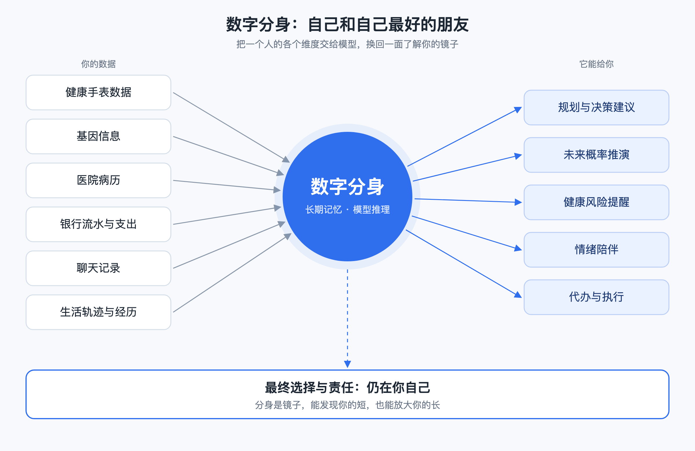

# 超级应用的方向：自己的数字分身

先说明一下，这篇是猜想，不是结论。可能不对，但我对它很有兴趣，所以想先写下来。

我一直在想，AI 的超级应用会是什么。

不是又一个更会聊天的助手，也不是又一个更会写代码的工具。我现在倾向于认为，它可能出现在个人身上：**一个真正了解你的数字分身**。

设想一下，如果把一个人的各个维度都交给模型：出生和成长的数据，各学科和各年级的学习经历，上过的学校，身体状况和看病记录，做过的事情和经历过的事情，买过的东西，家底和收入，银行流水和支出，聊天记录，生活轨迹。

模型把这些串在一起，就不再是一个每次都要重新介绍自己的陌生人，而是一个越来越了解你的存在。

它可以为你做规划，帮你分析决策，在你需要的时候给出建议。再往后，到了 AGI 时代，它甚至可以替你执行实地任务，你只需要提供想法。

我觉得它更有意思的一点，是**可以根据过去，给未来设一个概率**。

如果继续现在的路径，大概率会怎样？换一个选择，可能会怎样？职业、投资，甚至炒股，它可以结合你的性格告诉你：你容易在什么时候冲动，哪里是你一直在重复的老问题。

这样的它，可以成为**“自己和自己最好的朋友”**。

好朋友的价值，是了解你，愿意听你说，也愿意说真话。**它能发现你的短处，提醒你避开；也能看到你的长处，帮你放大。**它还可以给你情绪价值，在你低落的时候，不是泛泛地安慰，而是带着你过去的经历来回应。

**它还可能帮你发现自己。**

比如，每天戴在手上的健康手表，一直在记录心率、睡眠、活动量。这些数据单看只是一串数字，可是长期交给模型，再结合你的病史和家族情况，它也许能先发现一些不对劲的变化，提醒你某种疾病的可能，让你早一点去检查。

再往前想一步，如果在你自己同意的前提下，把基因信息也放进来，模型可以对照大量已有的研究，告诉你：你可能更容易出现哪些问题，应该提前注意什么；也可能告诉你，你在某些方面有天然的优势，适合往哪个方向发展。既是风险提示，也可能是好消息。

这个想法并不是凭空来的。据报道，孙宇晨就高度依赖 Claude 来处理工作和个人事务，还在做自己的 AI 分身。至于他把多少资料交给了 AI，公开报道里并没有完整说明，我这里只把它当作一个方向上的参考。

那现实里有没有这样的应用？

据我所知，目前还没有真正打通的。健康、财务、轨迹、照片、聊天，各有各的碎片，却分散在不同的平台里。医院、银行、社交软件互不相通，数据也被各自当作壁垒。

所以，我觉得**难点不在技术，而在数据归谁，以及愿不愿意打通。**这和我之前写的“AI 的瓶颈是权限”是同一件事，只是对象从公司换成了个人。

当然，这么私密的数据，安全是绕不开的。我在这里先不展开，这篇只想把猜想本身写清楚：如果这一切成立，会是什么样子。

我也明白，概率只是参考，不是判决。分身能给出镜子和建议，**最后的选择和责任，还是应该留给自己。**

**如果说超级应用有一个方向，我愿意押在这里：自己和自己最好的朋友。**

也许未来最了解你的，不是别人，而是另一个更清楚地记得你的自己。

我对这个方向非常感兴趣。它可能不对，但值得想一想。

  
   
  图：数字分身的设想结构

本文由 AI 整理文字。

