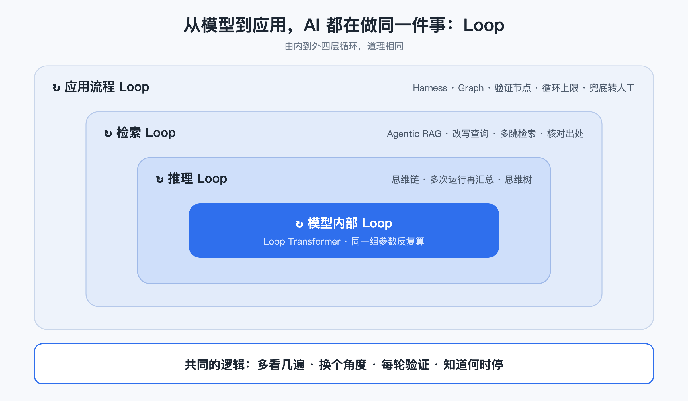

# 从模型到应用，AI 都在做同一件事：Loop

> 最近越来越觉得，loop 在 agent 里非常重要，而且像极了生活：不断循环，不断发现、细化，再发现新的东西。

---

## 一、Loop 像极了生活

人很少一次就把一件事想明白。

先做一遍，发现问题，换个角度再看，再修正。来回几次，才慢慢看清楚。AI 也是这样。

在 agent 里，有 agent loop，有工具调用的循环，也有专门设计循环的 loop engineering。说到底，它们做的是同一件事：**通过循环，从不同角度看问题、总结问题，得出不同的答案，再把这些答案汇总，结论就会更丰富、更准确。**

我越来越觉得，这不只是 agent 的技巧，而是 AI 从模型到应用，每一层都在用的逻辑。

---

## 二、模型层：多想几遍，就会更聪明

### 推理的循环

思维链（CoT）让模型先把思考过程写出来，再给答案。思维树（ToT）更进一步，从同一个问题出发，同时展开多条思路，逐个评估，保留好的，舍弃差的。

还有一种更直接的做法：**同一个问题让模型回答多次，每次换不同的参数和角度，再把结果汇总。** 多数一致的那个答案，往往更可靠。

模型端的算力会多花一点，但给用户的答案更准了。“回答时多花算力去思考”，已经是这几年最主要的发展方向之一，各家的推理模型基本都走在这条路上。

### 模型内部的循环

还有一条路，是让循环发生在模型内部，也就是 loop transformer。

普通的模型一层接一层往下算，算完就结束。循环式的模型则让**同一组参数反复算几遍**，把内部的理解一遍遍打磨。它不靠变大，而靠多想。

据报道，三星研究团队的 TRM 只有 700 万参数，靠反复循环，在抽象推理测试上的表现超过了不少大得多的模型。字节跳动也开源了循环式语言模型 Ouro，论文认为循环并不会增加模型记住的知识，却能明显提升它运用知识、推理的能力。

这条路目前还主要在研究阶段，但它说明了一件事：**模型变聪明，不一定要变大，也可以多想几遍。**

---

## 三、检索层：一次查不准，就再查一次

RAG 也是同样的思维。

传统的 RAG 只检索一次，然后生成答案。一次没查准，模型就只能基于错误的材料作答。

Agentic RAG 把检索变成了循环：

- 第一次没查到，就换个说法，或者拆成几个子问题再查；
- 有些问题要先查出 A，才知道该查 B，那就一跳一跳往下查；
- 检索回来的材料先评估一遍，不相关的丢掉，不够就换数据源；
- 生成之后，再核对每一句话有没有出处。

**它不再是“查一次就答”，而是“查到够了、对了，再答”。**

---

## 四、应用层：循环让产品更稳定可靠

做应用，也可以从这个思维出发，把 harness、loop engineering 和 graph 用起来。

| 概念 | 管什么 |
|---|---|
| Harness | 模型周围的一切：工具、上下文、权限、验证 |
| Loop engineering | 计划、执行、观察、验证、修正的循环怎么设计 |
| Graph | 把任务拆成明确的节点和走向，可控、可追踪、可回放 |

几个让产品更稳的做法：

- **每轮循环都有验证节点。** 能用代码判断的，就别交给模型判断。不通过，就带着原因回去重做。
- **给循环设上限。** 轮数、预算、时间都有边界，超过就交给人，或者走兜底方案。
- **关键路径用图固定下来。** 模型只负责节点里的判断，走向由流程控制，出了问题能定位到具体哪一步。
- **高风险的判断做多次、多角度。** 结果不一致，就升级给人。

**模型的能力决定了上限，应用里的循环和验证决定了下限。** 而用户感受到的，往往是下限。

---

## 五、循环不是越多越好

说到这里，还有一点同样重要：**loop 有效的前提，是每一轮都有反馈和验证。**

agent 写代码能越改越好，是因为有测试和报错告诉它对不对。如果没有判断标准，循环越多，花费越大，甚至可能把错误放大。

研究里也有类似的发现：循环式模型循环太多次，效果反而会变差；有的模型只多循环一次效果最好，再多就开始掉分。

这一点也像生活。**有反馈的循环叫成长，没有反馈的循环叫内耗。** 反复琢磨能让人看得更透，琢磨过头，就成了钻牛角尖。

---

## 写在最后

回头看，这条线其实很清楚：

**模型内部在循环，推理过程在循环，检索在循环，应用流程也在循环。** 每一层的道理都一样。

> **多看几遍，多换几个角度，每一轮都验证，并且知道什么时候停。**
>
> 这也许就是 AI 变聪明、变可靠的共同逻辑。

  
   
  图：从模型到应用的四层 Loop

本文由 AI 整理文字。 2026-11-27

